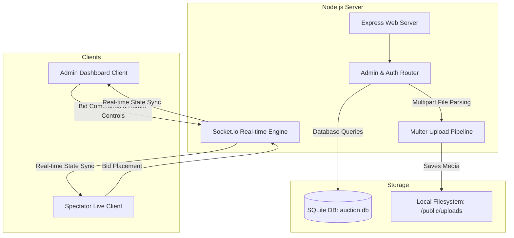

# 🏏 Indian Premier League - Live Auction SaaS Platform
## Technical Architecture & Developer Documentation

Welcome to the comprehensive system documentation for the IPL Live Auction application. This document describes the architecture, data structures, communication systems, and functional business flows that power the real-time, zero-latency draft platform.

---

## 1. Architectural Overview

The application is built on a high-concurrency, real-time event-driven architecture using **Node.js**, **Express**, **SQLite**, and **Socket.io**. It is designed to host zero-latency auction streams that sync perfectly across administrative screens and public spectator viewports.



### Tech Stack Components:
*   **Web Framework**: `Express.js` (Server backend, static directory hosting, session authentication).
*   **Template Rendering**: `EJS` (Embedded JavaScript templates for premium server-side rendering).
*   **Real-time Communication**: `Socket.io` (Bidirectional, persistent TCP web sockets for instant bid and timer sync).
*   **Database**: `SQLite` (via `sqlite` and `sqlite3` driver - zero-config embedded transactional database).
*   **Media Pipeline**: `Multer` (Disk storage file uploads for franchise logos and player photos).
*   **Styling System**: CSS Variables + Custom HSL color spaces (Glassmorphic layouts, dark mode optimized, high visual hierarchy).

---

## 2. Directory & File Mapping

```
auction/
├── models/
│   └── data.js           # Core database connection, tables init, and database queries
├── routes/
│   └── admin.js          # Administration control endpoints and file upload handlers
├── sockets/
│   └── index.js          # Web socket server connection manager & real-time bid logic
├── views/
│   ├── admin/
│   │   ├── dashboard.ejs # Main Admin Console (draft controller, listings, budget tools)
│   │   ├── players.ejs   # Admin player management list template
│   │   └── teams.ejs     # Admin team/franchise registration template
│   ├── user/
│   │   └── dashboard.ejs # Spectator viewport screen (glowing layouts, live stats, team list)
│   ├── index.ejs         # Landing page template
│   ├── login.ejs         # Authentication portal
│   └── register.ejs      # User registration form
├── public/
│   ├── css/
│   │   └── style.css     # Master design system (glassmorphism tokens, alerts, layouts)
│   ├── js/
│   │   ├── admin.js      # Client-side Socket.io and EJS controllers for Admin
│   │   └── user.js       # Client-side Socket.io and DOM controllers for Spectator
│   └── uploads/
│       ├── default-player.svg # Custom premium neon-silhouette avatar fallback
│       └── [files]       # Uploaded player pictures & franchise logos
├── auction.db            # Active SQLite database file
├── server.js             # Entry point (bootstraps server, sessions, socket and ports)
└── package.json          # Node dependencies list
```

---

## 3. Database Schema (`models/data.js`)

SQLite is initialized automatically on server boot. Dynamic tables structure data as follows:

### `users` Table (System Authentication)
Defines platform credentials and authorization privileges:
*   `username` (TEXT, PRIMARY KEY): Plain-text unique user identification.
*   `password` (TEXT): Encrypted user credentials.
*   `role` (TEXT): Access control scope (e.g. `'admin'` or Franchise Name).

### `teams` Table (Franchise Accounts)
Stores point ledger values, display styles, and identity assets:
*   `id` (TEXT, PRIMARY KEY): Unique UUID string.
*   `name` (TEXT): Display name of the franchise (e.g. `'Mumbai Indians'`).
*   `budget` (INTEGER): Points purse remaining for bidding.
*   `color` (TEXT): Primary theme hex-color code (used for styling cards and avatars).
*   `logo` (TEXT): Relative file path to the uploaded franchise logo image.

### `players` Table (Auction Roster)
Stores point values, status conditions, and player profiles:
*   `id` (TEXT, PRIMARY KEY): Unique UUID string.
*   `name` (TEXT): Player full name.
*   `basePrice` (INTEGER): Base bidding price starting point.
*   `role` (TEXT): Playing specialty (Batsman, Bowler, All-Rounder, Wicket-Keeper).
*   `phone` (TEXT): Player phone number (visible on Admin / Live detail panels).
*   `photo` (TEXT): File path to the uploaded profile photo.
*   `status` (TEXT): State condition (`'available'`, `'sold'`, `'unsold'`).
*   `soldTo` (TEXT, NULLABLE): Name of the purchasing team.
*   `soldPrice` (INTEGER, NULLABLE): Point price paid for the player.

---

## 4. Key Functions & Business Logic

### A. Automatic Next-Player Drafting (`sockets/index.js` ➡️ `handleAuctionEnd`)
When an active auction ends—due to natural timeout (timer reaches `0`), a manual click on **✓ SOLD (S)**, or **✕ UNSOLD (U)**—the server runs the `handleAuctionEnd()` routine:

1.  **Deduction & Sold Processing**: If a highest bidder exists, the player's status is saved as `'sold'` with their sold price. The system queries the team's remaining budget, subtracts the final bid, updates the SQLite ledger, and triggers a dynamic database commit.
2.  **Unsold Processing**: If no bids were placed, status is updated as `'unsold'`.
3.  **Broadcasts Overlays**: Instantly broadcasts `auctionEnd` and `dataUpdate` events. All screen viewports freeze and show a beautiful blinking status banner overlay (**SOLD** or **UNSOLD**) for **exactly 4 seconds**.
4.  **Auto-Load Next Queue**: During the 4-second delay, the server queries the database for the *first available player* who is still marked `'available'`.
    *   **If found**: Automatically resets bidding values, sets the timer to `30`, sets status to `'active'`, and launches the next draft cycle cleanly.
    *   **If empty**: Moves the platform to a `'finished'` state, causing both Admin and Live dashboards to gracefully render a completion card: **"NO PLAYERS FOR BIDDING - All players have been successfully auctioned!"**.

### B. Math Casting and Console Desync Protection (`models/data.js` ➡️ `resetPlayer`)
During a player re-auction reset, two classic bugs are prevented:
1.  **Strict parseInt Casting**: To avoid budget corruption where adding numbers treats them as strings (e.g. `100000 + "1500" = "1000001500"`), the refund formula casts operands strictly:
    ```javascript
    team.budget = parseInt(team.budget) + parseInt(player.soldPrice || 0);
    ```
2.  **Active Panel Desync Cleanup**: If a player being reset is currently the loaded candidate on the bidding console, the system cleans the live cache:
    ```javascript
    if (this.auctionState.currentPlayer && this.auctionState.currentPlayer.id === playerId) {
        this.auctionState.currentPlayer = null;
        this.auctionState.currentBid = 0;
        this.auctionState.highestBidder = null;
        this.auctionState.status = 'waiting';
    }
    ```

### C. Budget Modifier Capture Strategy (`public/js/admin.js`)
Forms submitting multiple actions with standard buttons (such as **+ ADD** and **- DEDUCT**) encounter compatibility failures across standard web browsers when reading clicked attributes directly from `FormData`.
*   **The Solution**: A hidden input field (`<input type="hidden" name="actionType" id="budgetActionType">`) is placed inside the form.
*   Each submit button has an inline `onclick` handler that sets the action string (`'add'` or `'deduct'`) to the hidden input *before* the form submits.
*   The event listener checks the value seamlessly:
    ```javascript
    const isDeduct = formData.get('actionType') === 'deduct';
    const amount = isDeduct ? -rawAmt : rawAmt;
    ```

---

## 5. Web Socket Communication Registry

The real-time sync layer handles persistent bidirectional events over the open TCP socket stream:

| Event Name | Sender | Payload | Description |
| :--- | :--- | :--- | :--- |
| **`auctionUpdate`** | Server | `auctionState` | Broadcasts running game variables (currentPlayer, currentBid, highestBidder, timer, status). |
| **`dataUpdate`** | Server | `{ teams, players }` | Broadcasts complete updated lists of sorted players and sorted teams. |
| **`timerUpdate`** | Server | `timer` (Integer) | Emitted once every second to countdown the draft clock. |
| **`bidUpdate`** | Server | `{ currentBid, highestBidder }` | Broadcasts a validated higher bid, triggering flashing CSS highlights. |
| **`bidError`** | Server | `errorMessage` (String) | Direct private socket response to client if a bid is illegal (insufficient budget, out of order). |
| **`startAuction`** | Admin | `{ playerId }` | Initiates the live timer and bidding session for a specific player. |
| **`placeBid`** | Client | `{ teamName, bidAmount }` | Submits a new point bid. Checks validity before database/state commits. |
| **`resetTimer`** | Admin | None | Resets the 30-second draft clock for the current player. |
| **`endAuction`** | Admin | `{ selectedTeamName }` | Manually forces a standard sold outcome using current highest bidder. |
| **`forceUnsold`** | Admin | None | Manually forces the current player status to `'unsold'`. |
| **`adminDataAdded`**| Admin | None | Socket notification that admin modified database contents (budgets, additions), triggering system re-broadcast. |

---

## 6. Setup & Operational Guide

### 📋 Prerequisites
*   [Node.js](https://nodejs.org/) installed (v16.x or higher recommended).
*   Active browser client with CSS/HTML5 support.

### 🚀 Starting the Platform
To boot up the complete environment in developer mode:
1.  Navigate into the main project root folder:
    ```powershell
    cd "c:\Users\Nisha Singh\auction"
    ```
2.  Install dependencies (if setting up on a new device):
    ```powershell
    npm install
    ```
3.  Launch the services:
    ```powershell
    npm start
    ```
4.  Open your browser to the following local URLs:
    *   **Spectator Live Viewport**: `http://localhost:3000/live`
    *   **Franchise Control Console**: `http://localhost:3000/` (Log in with registered Team Credentials)
    *   **Master Administrative Tools**: `http://localhost:3000/admin/dashboard` (Credentials: `admin` / `admin`)

---
**🏆 System Document Finalized | Clean, Automated, & Scale-ready.**
